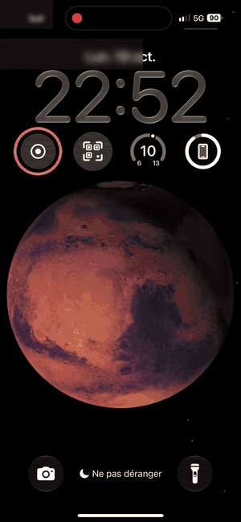
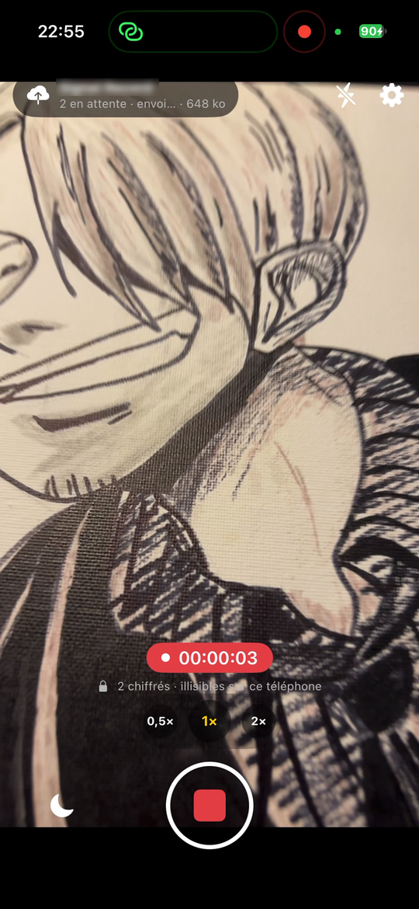
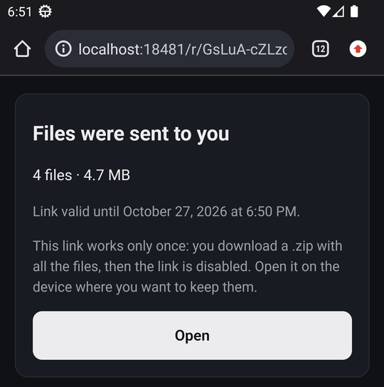

<p align="center">
  
</p>

<h1 align="center">Témoin</h1>

<p align="center">
  Filmer. Chiffrer. Envoyer <strong>pendant qu'on filme</strong>. Rien ne reste lisible sur le téléphone.
</p>

<p align="center">
  <a href="README.md">🇬🇧 English version</a> ·
  <a href="docs/SELF-HOSTING.md">Auto-hébergement</a> (en anglais) ·
  <a href="docs/THREAT-MODEL.md">Modèle de menace</a> ·
  <a href="docs/PRIVACY.md#politique-de-confidentialité">Confidentialité</a> ·
  <a href="docs/PROTOCOL.md">Protocole</a> ·
  <a href="SECURITY.md">Sécurité</a>
</p>

---

## Pourquoi

Quand les images que l'on filme comptent, **le téléphone est le point faible** : il peut être saisi, cassé, effacé ou perdu, et celui qui le tient peut regarder, supprimer ou diffuser ce qui a été filmé.

Témoin fait sortir les images du téléphone **pendant l'enregistrement**, chiffrées de sorte que :

- le téléphone **ne peut pas relire** ce qu'il a filmé (il n'a que la clé *publique* du serveur) ;
- le serveur **ne peut pas lire** ce qu'il stocke (il n'a jamais la clé privée) ;
- seul l'organisateur, avec une clé privée gardée sur son propre ordinateur, peut déchiffrer — et peut ensuite **rendre à chacun ses propres enregistrements** par un lien à usage unique.

Un téléphone perdu ou pris en plein tournage ne perd que les 2 à 4 dernières secondes.

## 📲 Installer l'app

| | |
|---|---|
| **iPhone** | **[Rejoindre la bêta publique sur TestFlight](https://testflight.apple.com/join/DYbucJRp)** : installez l'app *TestFlight* d'Apple, ouvrez le lien, touchez *Accepter* puis *Installer*. La version App Store est en cours de vérification. |
| **Android** | **[Télécharger l'APK](../../releases/latest)** (`Temoin-vX.Y.Z-android.apk`) et l'installer directement, voir ci-dessous. Google Play arrive. |
| **Serveur** | L'app envoie vers *votre* serveur : installez l'appli de bureau (Windows, Mac) ou Docker, voir [Démarrer](#démarrer). |

<details>
<summary><strong>Installer l'APK Android</strong> (hors Google Play)</summary>

1. Sur le téléphone, ouvrez la [dernière version](../../releases/latest) et téléchargez `Temoin-vX.Y.Z-android.apk`.
2. Ouvrez le fichier téléchargé. Android demande d'autoriser l'installation depuis cette source (votre navigateur ou gestionnaire de fichiers) : autorisez, revenez en arrière, touchez **Installer**.
3. Si Play Protect prévient que l'app est inconnue, touchez **Plus de détails → Installer quand même** : l'app n'est pas encore sur Google Play, donc Google ne l'a pas analysée.
4. Facultatif, pour vérifier l'APK : l'empreinte SHA-256 de son certificat de signature est
   `E3:86:BB:5F:3D:38:07:BB:2B:19:7F:9A:B3:3F:AC:F7:BC:F1:05:EF:7A:5E:DF:8F:50:36:A6:A6:FF:7B:B4:CA`
   (`apksigner verify --print-certs Temoin-*.apk`). Les mises à jour doivent être signées avec la même clé.

Android 10 ou plus récent. L'app se mettra à jour depuis Google Play une fois publiée là-bas.
</details>

> [!IMPORTANT]
> **On cherche des testeurs Android 🙋** Google ne publie les apps des nouveaux comptes développeur qu'après un test fermé avec **au moins 12 testeurs pendant 14 jours**. Si vous avez un téléphone Android et pouvez garder l'app installée deux semaines (en l'utilisant de temps en temps), envoyez l'adresse Gmail de votre compte Google à **max.aumard93@gmail.com** avec l'objet *Testeur Témoin*. Vous recevrez un lien d'invitation pour installer l'app depuis Google Play. Merci !

## Comment ça marche

```
 Téléphone (Android / iOS)                   Votre serveur (PC, NAS, VPS)               Ordinateur de l'organisateur
 ─────────────────────────                   ────────────────────────────               ────────────────────────────
 caméra → segments de 2–4 s                  ne stocke que du chiffré,                  clé privée (protégée par phrase de passe)
 → chiffrés en mémoire (age, X25519) ─HTTPS─▶ écriture seule, registre chaîné  ─copie─▶ déchiffre, rassemble MP4/JPEG
 → envoyés aussitôt, puis effacés            aucune route pour lister ou lire          → liens à usage unique pour rendre les fichiers
```

- **Chiffrement** : fichiers [age](https://age-encryption.org) v1 standard (X25519, ChaCha20-Poly1305), déchiffrables aussi avec l'outil `age` officiel.
- **Pas de comptes** : chaque téléphone rejoint le serveur en scannant un QR d'invitation et crée sa propre clé Ed25519. Le serveur ne connaît qu'un pseudonyme (« Phone #37 »), peut le bannir, ne sait jamais qui est qui.
- **Infalsifiable** : chaque objet reçu est inscrit dans un registre chaîné par hash (`sr verify`).
- **Restitution** : la personne demande ses fichiers dans l'app et obtient un code court ; l'organisateur en fait un lien à usage unique, depuis la page d'administration ou l'appli de bureau. Les fichiers sont rechiffrés avec une clé neuve qui n'existe que dans le lien (`/r/<id>#<clé>`) : le serveur ne la voit jamais. La personne récupère un `.zip` dans n'importe quel navigateur, sans l'app.
- **Rien n'est jamais supprimé** du serveur : les enregistrements rendus sont mis de côté et ne comptent plus dans le quota de l'appareil.

## Captures

| Serveur de bureau (Windows, macOS) | Page d'administration | Lien de restitution |
|---|---|---|
|  |  |  |

**Sur le téléphone**

| Un appui sur l'écran verrouillé et ça filme | Pendant qu'on filme : chiffré et envoyé toutes les quelques secondes | Ses fichiers rendus par un lien à usage unique |
|---|---|---|
|  |  |  |

Vrai iPhone, version précédente (l'ancien nom de l'app est flouté). La page du lien vient de l'émulateur Android.

## Contenu du dépôt

| Dossier | Quoi | Technique |
|---|---|---|
| [`android/`](android) | App téléphone | Kotlin, Jetpack Compose, Camera2, MediaCodec, muxer MPEG-TS maison |
| [`ios/`](ios) | App téléphone | SwiftUI, AVFoundation (segments fMP4), XcodeGen |
| [`server/`](server) | Serveur (image Docker ou service Linux) + outil `sr` de l'opérateur | Rust, axum |
| [`desktop/`](desktop) | **Serveur pour votre propre ordinateur** (installeur Windows, image disque macOS) : assistant, accès Internet, invitations, récupération | Rust, Tauri |
| [`docs/`](docs) | Protocole, modèle de menace, auto-hébergement, plan de tests de sécurité | |
| [`tools/`](tools) | Vérifications d'interopérabilité (l'outil `age` officiel déchiffre ce que produit chaque app) | |

## Démarrer

**1. Un serveur**, au choix :

- **Un PC Windows à la maison** — installez *Témoin Server* (`Témoin Server_x.y.z_x64-setup.exe` dans les [releases](../../releases)). Au premier lancement, l'appli crée votre clé (protégée par une phrase de passe), puis **Démarrer** donne une adresse publique `https://…` via un tunnel Cloudflare : ni compte, ni réglage de la box.
- **Mac** — même appli : `Témoin Server_x.y.z_universal.dmg` (Apple Silicon et Intel). Signée et notarisée par Apple. Expérimentale : testée d'abord sous Windows, les retours d'utilisateurs Mac sont bienvenus.
- **Docker** (NAS, VPS, machine Linux) — `ghcr.io/temoin-app/temoin-server`, voir l'[auto-hébergement](docs/SELF-HOSTING.md).
- **Service Linux** sans Docker — un binaire statique + une unité systemd, voir l'[auto-hébergement](docs/SELF-HOSTING.md).

**2. Les téléphones.** Installez l'app, voir [Installer l'app](#-installer-lapp) (TestFlight sur iPhone, APK sur Android). Puis scannez un QR d'invitation de votre serveur, filmez.

**3. Récupérer.** Sur l'ordinateur qui a la clé : **Récupérer** dans l'appli de bureau, ou `sr decrypt` en ligne de commande.

## Plateformes et limites

| | Android | iOS |
|---|---|---|
| Photo / vidéo / « live » (segments courts) | ✓ | ✓ |
| Aucun fichier en clair écrit sur le stockage | ✓ | ✓ |
| Envoi pendant l'enregistrement, reprise après coupure | ✓ | ✓ |
| Filmer écran verrouillé / app en arrière-plan | ✓ | ✗ (interdit par iOS — mode écran noir à la place) |
| Lancer depuis l'écran verrouillé (tuile / contrôle / raccourci) | ✓ | ✓ |
| Caméra / micro USB-C externe | ✓ (Android 14+, selon le téléphone) | micro seulement |
| Code « Récupérer mes fichiers » | ✓ | ✓ |

Lisez le [modèle de menace](docs/THREAT-MODEL.md) avant de compter sur Témoin : ce qu'il protège, et ce qu'il **ne protège pas** (l'écran et la mémoire du téléphone contiennent l'image quelques secondes ; le serveur et un éventuel tunnel voient les IP, tailles et heures).

## Projets proches

Témoin s'appuie sur des idées d'outils existants :

- [**Tella**](https://tella-app.org) (Horizontal) — documentation chiffrée et rapports vers Tella Web / Uwazi / ODK. Témoin se concentre sur l'envoi *pendant* l'enregistrement, vers un serveur qui ne peut pas lire les médias.
- [**Cryptocam**](https://f-droid.org/packages/com.tnibler.cryptocam/) — caméra Android qui chiffre avec age pendant l'enregistrement, mais garde les fichiers sur le téléphone.
- [**Save**](https://open-archive.org) (OpenArchive) — envoie les médias vers Nextcloud ou l'Internet Archive ; seul le transport est chiffré, la destination peut lire les fichiers.
- [**ProofMode**](https://guardianproject.info/apps/org.witness.proofmode/) (Guardian Project) — signe les médias pour prouver leur authenticité. Complémentaire ; une intégration est envisageable.
- [**eyeWitness to Atrocities**](https://www.eyewitness.global) — capture vérifiée avec chaîne de traçabilité, envoyée vers un dépôt central géré par l'organisation.
- **ACLU Mobile Justice** — envoi automatique des vidéos à l'ACLU ; [fermée en février 2025](https://en.wikipedia.org/wiki/ACLU_Mobile_Justice).

Ce que Témoin apporte : **envoi pendant le tournage** + **serveur auto-hébergé qui ne peut rien lire** + **identité anonyme par téléphone** + **liens de restitution à usage unique** + **un simple PC à la maison suffit**.

## Écrit avec une IA

Témoin a été en grande partie écrit avec un assistant de programmation IA ([Claude Code](https://claude.com/claude-code)) — « vibe-codé », sous direction humaine, et testé par un humain sur de vrais téléphones et un vrai déploiement. Chaque composant a des tests automatiques, et la CI vérifie que l'outil `age` officiel déchiffre ce que produisent les codes Kotlin, Swift et Rust.

Mais : **personne n'a encore audité ce code.** Le chiffrement age est réimplémenté en Kotlin et en Swift. Considérez Témoin comme un **logiciel alpha**, relisez-le et [signalez ce que vous trouvez](SECURITY.md). Une relecture indépendante est la contribution la plus utile aujourd'hui.

## État et feuille de route

Alpha. Fonctionne de bout en bout aujourd'hui : apps Android et iOS, serveur Docker/Linux, serveur de bureau Windows (version macOS disponible, expérimentale) avec tunnel rapide ou HTTPS intégré, récupération, liens de restitution.

Ensuite : audit de sécurité externe · distribution App Store / Play Store / F-Droid · appli de bureau Linux · adresse stable sans nom de domaine pour les serveurs maison · signatures ProofMode/C2PA en option.

## Contribuer

Tickets et pull requests bienvenus — voir [CONTRIBUTING.md](CONTRIBUTING.md). Failles de sécurité : suivez [SECURITY.md](SECURITY.md) plutôt qu'un ticket public.

## Licence

[GNU AGPL-3.0-or-later](LICENSE). Si vous faites tourner un serveur modifié pour d'autres, vous devez partager vos modifications.

L'appli de bureau embarque [`cloudflared`](https://github.com/cloudflare/cloudflared) de Cloudflare (Apache-2.0), sans modification.
