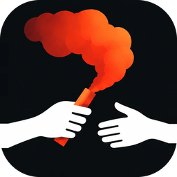
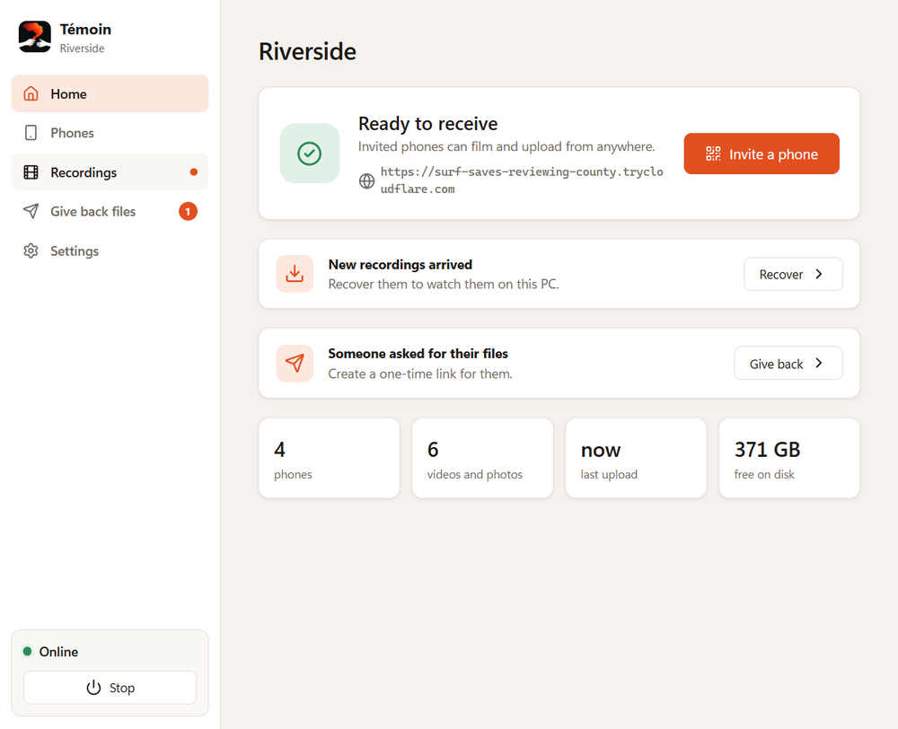
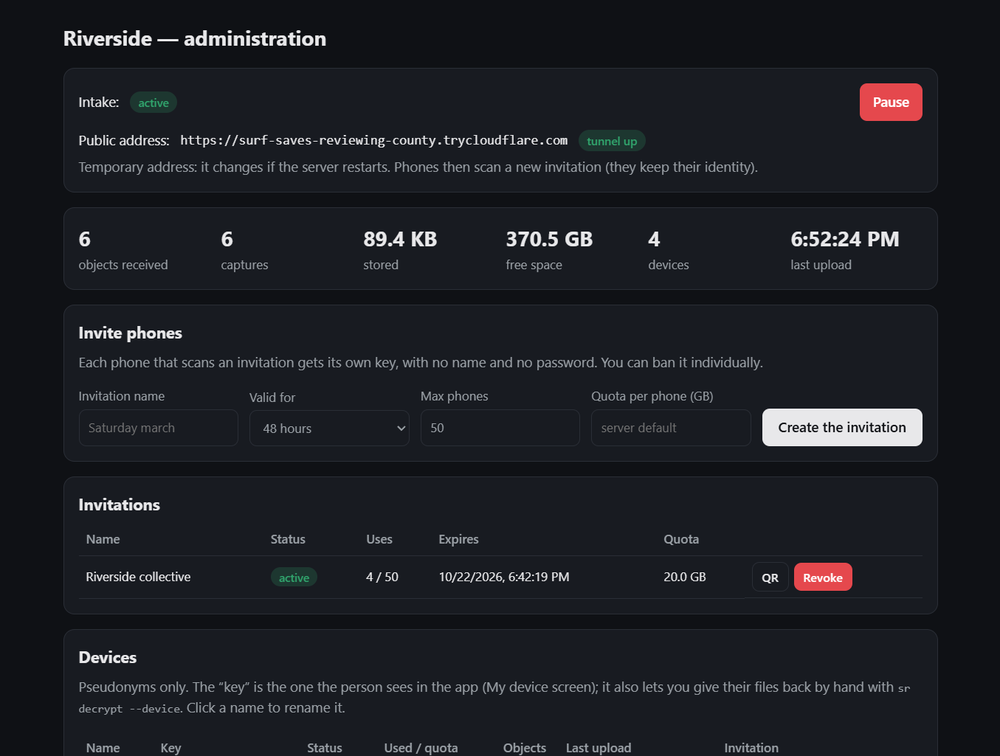
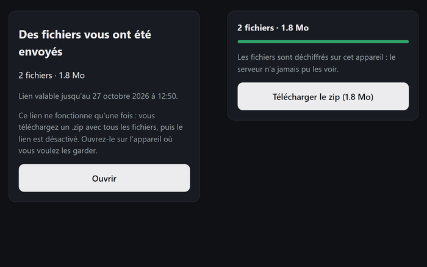

<p align="center">
  
</p>

<h1 align="center">Témoin</h1>

<p align="center">
  <em>“Témoin” is French for <strong>witness</strong>.</em><br>
  Film. Encrypt. Upload <strong>while filming</strong>. Nothing readable stays on the phone.
</p>

<p align="center">
  <a href="README.fr.md">🇫🇷 Version française</a> ·
  <a href="docs/SELF-HOSTING.md">Self-hosting</a> ·
  <a href="docs/THREAT-MODEL.md">Threat model</a> ·
  <a href="docs/PROTOCOL.md">Protocol</a> ·
  <a href="SECURITY.md">Security</a>
</p>

<p align="center">
  
  
  
</p>

---

## Why

When you film a protest, a police stop or any event where the footage matters, **the phone is the weak point**: it can be seized, broken, wiped or simply lost, and whoever holds it can watch, delete or leak what you filmed.

Témoin moves the footage off the phone **as it is being recorded**, encrypted so that:

- the phone **cannot read back** what it filmed (it only has the server's *public* key);
- the server **cannot read** what it stores (it never has the private key);
- only the organizer, with a private key kept on their own computer, can decrypt — and can then **hand each person their own recordings back** through a one-time link.

A phone snatched mid-recording loses only the last 2–4 seconds.

## How it works

```
 Phone (Android / iOS)                       Your server (home PC, NAS, VPS)            Organizer's computer
 ─────────────────────                       ───────────────────────────────            ────────────────────
 camera → 2–4 s segments                     stores ciphertext only,                    private key (passphrase-protected)
 → encrypted in RAM (age, X25519)  ──HTTPS──▶ write-only, hash-chained ledger  ──copy──▶ decrypts, reassembles MP4/JPEG
 → uploaded at once, then deleted            no route to list or download              → one-time links to hand files back
```

- **Encryption**: standard [age](https://age-encryption.org) v1 files (X25519, ChaCha20-Poly1305). Anything you store can also be decrypted with the official `age` tool.
- **No accounts**: each phone joins by scanning an invitation QR and gets its own Ed25519 key. The server only knows a pseudonym (“Phone #37”), can ban a device, never knows who is who.
- **Tamper-evident**: every stored object is recorded in a hash-chained ledger (`sr verify`).
- **Hand-back**: a person asks for their files in the app and gets a short code; the organizer turns it into a one-time link. The files are re-encrypted with a fresh key that only exists in the link (`/r/<id>#<key>`): the server never sees it. The recipient gets a `.zip` in any browser, no app needed.
- **Nothing is ever deleted** on the server: handed-back recordings are moved aside and stop counting against the device quota.

## Screenshots

| Desktop server (Windows) | Admin page | One-time hand-back link |
|---|---|---|
|  |  |  |

Phone screenshots and a short demo video are coming with the first public build of the renamed apps.

## What's in this repository

| Folder | What | Tech |
|---|---|---|
| [`android/`](android) | Phone app | Kotlin, Jetpack Compose, Camera2, MediaCodec, own MPEG-TS muxer |
| [`ios/`](ios) | Phone app | SwiftUI, AVFoundation (fMP4 segments), XcodeGen |
| [`server/`](server) | Server (Docker image or Linux service) + `sr` operator CLI | Rust, axum |
| [`desktop/`](desktop) | **Server for a home PC** (Windows installer): setup wizard, Internet access, invitations, recovery | Rust, Tauri |
| [`docs/`](docs) | Protocol, threat model, self-hosting, security test plan | |
| [`tools/`](tools) | Interoperability checks (official `age` decrypts every app's output) | |

## Get started

**1. A server.** Pick one:

- **Windows PC at home** — install *Témoin Server* (`Témoin Serveur_x.y.z_x64-setup.exe` from the [releases](../../releases)). First launch creates your key (protected by a passphrase), then **Start** gives you a public `https://…` address through a Cloudflare quick tunnel: no account, no router setup.
- **Docker** (NAS, VPS, Linux box) — `ghcr.io/temoin-app/temoin-server`, see [self-hosting](docs/SELF-HOSTING.md).
- **Linux service** without Docker — single static binary + systemd unit, see [self-hosting](docs/SELF-HOSTING.md).

**2. The phones.** Install the app ([releases](../../releases): Android APK; iOS currently as an unsigned IPA to sideload — App Store distribution is on the roadmap), scan an invitation QR from your server, film.

**3. Recover.** On the computer holding the key: **Recover** in the desktop app, or `sr decrypt` from the command line.

## Platforms and limits

| | Android | iOS |
|---|---|---|
| Photo / video / “live” (short segments) | ✓ | ✓ |
| No plaintext ever written to storage | ✓ | ✓ |
| Upload during recording, resume after network loss | ✓ | ✓ |
| Record with the screen locked / app in background | ✓ | ✗ (iOS forbids it — black-screen mode instead) |
| Start from the lock screen (tile / control / shortcut) | ✓ | ✓ |
| External USB-C camera / microphone | ✓ (Android 14+, device-dependent) | mic only (camera: iPadOS 17+) |
| “Get my files back” request code | ✓ | ✓ |

Read the [threat model](docs/THREAT-MODEL.md) before relying on Témoin: what it protects, and what it does **not** (e.g. the phone's screen and RAM hold the image for a few seconds; the server and any tunnel see IPs, sizes and times).

## Similar projects

Témoin builds on ideas from tools that came before it:

- [**Tella**](https://tella-app.org) (Horizontal) — encrypted documentation and reports to Tella Web / Uwazi / ODK. Témoin focuses on uploading *during* recording, to a server that cannot read the media.
- [**Cryptocam**](https://f-droid.org/packages/com.tnibler.cryptocam/) — Android camera that encrypts with age as it records, but keeps the files on the phone.
- [**Save**](https://open-archive.org) (OpenArchive) — uploads media to Nextcloud or the Internet Archive; transport encryption only, the destination can read the files.
- [**ProofMode**](https://guardianproject.info/apps/org.witness.proofmode/) (Guardian Project) — signs media to prove authenticity. Complementary; integration is a possible future direction.
- [**eyeWitness to Atrocities**](https://www.eyewitness.global) — verified capture with chain of custody, uploaded to a central repository run by the organization.
- **ACLU Mobile Justice** — auto-uploaded police-encounter recordings to the ACLU; [shut down in February 2025](https://en.wikipedia.org/wiki/ACLU_Mobile_Justice).

What Témoin adds: **upload while filming** + **a self-hosted server that cannot read anything** + **anonymous per-phone identities** + **one-time hand-back links** + **an ordinary home PC is enough**.

## Built with AI

Témoin was largely written with an AI coding assistant ([Claude Code](https://claude.com/claude-code)) — “vibe-coded”, under human direction, with human testing on real phones and a real deployment. Every component has automated tests, and the CI checks that the official `age` tool decrypts what the Kotlin, Swift and Rust code produce.

That said: **nobody has audited this code yet.** The age encryption is re-implemented in Kotlin and Swift. Please treat Témoin as **alpha software**, review it, and [report anything you find](SECURITY.md). Independent review is the most valuable contribution right now.

## Status and roadmap

Alpha. Working end to end today: Android and iOS apps, Docker/Linux server, Windows desktop server with quick tunnel or built-in HTTPS, recovery, hand-back links.

Next: external security review · App Store / Play Store / F-Droid distribution · desktop app for macOS and Linux · stable address without a domain for home servers · optional ProofMode/C2PA signatures.

## Contributing

Issues and pull requests are welcome — see [CONTRIBUTING.md](CONTRIBUTING.md). Security issues: please follow [SECURITY.md](SECURITY.md) instead of opening a public issue.

## License

[GNU AGPL-3.0-or-later](LICENSE). If you run a modified server for others, you must share your changes.

The Windows installer bundles Cloudflare's [`cloudflared`](https://github.com/cloudflare/cloudflared) (Apache-2.0), unmodified.
